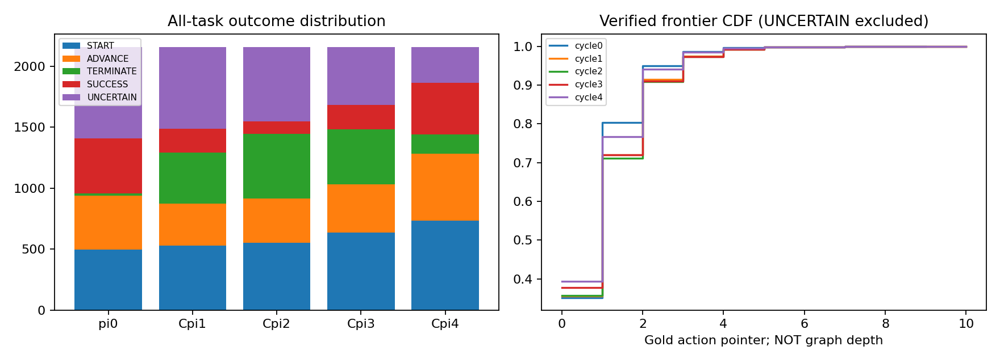

# EnvFactory / Recursive OPD 研究探索 — 2026-10-07

VERDICT（现有资产审计）= **未发现足以确认结构迁移或自动 curriculum 的正结果。**

首选验证型研究主线是“状态可恢复条件下，局部干预是否提高深层、可学习 correction 的采集效率”，而不是继续把当前递归链包装成已经有效的方法。本文区分已观察事实、探索性关联与待验证假说。Recovery 的最终数字见第 4 节。

## 1. Exposure-conditioned OPD audit

### 数据和 exposure 证据

远端根目录 `/home/u2024311031/workspace/envfactory_repro_1p7b`；本报告只写本机。没有改训练代码、运行优化器或新建训练数据集。

- π0：`repro_1p7b/graph_frontier/recursive_opd_v1_run/cycle0/`。
- Cπ1–Cπ4：`repro_1p7b/graph_frontier/recursive_opd_v3_experiment_run/cycle1/` 至 `cycle4/`。
- 每个 policy 的 `metrics/per_task.jsonl`、`rollouts/<task_id>.json`，以及固定 `protocol.json`、`rollout_manifest.json`。
- 每次更新的 `train_plan.json`（由 extractor 记录实际路径）、自然/anchor dataset、最终 checkpoint 的 `trainer_state.json`、成功 attempt 的 `result.json` 和逐步训练日志；所有完整路径、hash 和源行 identity 保存在 `research_assets_20261007.json`。
- 复用逐任务执行验证审计 `paired_fd_correction_audit_20261007.json`，不是按摘要猜 crossing。

证据链是：**保留的 checkpoint → 与其相同 result 的唯一成功 attempt → 连续 optimizer steps → 每 rank 的 exposure tag → 固定 plan stream 的 source/index/identity → 实际 dataset row**。原 trainer 日志不直接记录每个 task_id；身份是通过该确定性输入流重建，并逐项核对 source verdict、frontier、regime、query hash。不能称为直接的 per-example task-ID 日志。

cycle0 另有失败 attempt `train_metrics_20260928T075951Z_24384`：记录了 64 steps，但没有成功 result，不是最终 checkpoint 对应 attempt，**不计入该 policy 的实际 exposure**。

只把 `complete_c_source_label=CURRENT_FRONTIER_CORRECTION` 算 MAIN correction。Continuation、terminal-positive、fresh crossed anchor 单列，不能把它们冒充 FIRST_ERROR correction。TERMINATE 首错属于 MAIN；terminal-positive 成功样本不属于 MAIN。

| 更新 | 实际 optimizer steps | 总 exposure | MAIN 首错任务事件 | MAIN START / ADVANCE / TERMINATE |
|---|---:|---:|---:|---:|
| π0→Cπ1 | 64 | 128 | 62 | 24 / 37 / 1 |
| Cπ1→Cπ2 | 87 | 174 | 88 | 40 / 21 / 27 |
| Cπ2→Cπ3 | 70 | 140 | 96 | 29 / 28 / 39 |
| Cπ3→Cπ4 | 68 | 136 | 95 | 40 / 29 / 26 |

共 578 exposure，其中 341 个 MAIN task-transition 事件；**341 个都恰好 exposure 一次**，不是充分重复训练。Anchor 增加实际 steps，不能说四次更新都固定 64 steps。自然 128 行均匀不放回抽样，必要时一个 parity filler；合格历史 crossed anchors 全部 exposure，后者非随机。未 MAIN exposure 的 train FIRST_ERROR 有 3,766 个，其中 101 个接受了其他类型 exposure。

### 核心结果

主对照限定 train FIRST_ERROR；heldout 不混入 unexposed train。严格跨越要有实际 typed action、response/state 和后继有效状态，TERMINATE 要真实正确停止。未知不当作失败，也不按 final success 反推。

Frontier progression = 相邻轮均非 UNCERTAIN 且下一轮 verified gold-action pointer 严格增加。该 pointer **不是 dependency graph depth**；正确终止可能修复首错却不能增加 pointer，因此 crossing 与 progression 不是同一指标。

| Metric | Exposed correction | Unexposed correction | 绝对差 pp | 相对差 | task-cluster bootstrap 95% CI（差 pp） |
|---|---:|---:|---:|---:|---:|
| Exact FD crossed | 23/309 = 7.44% | 282/3495 = 8.07% | −0.63 | −7.75% | [−3.53, +2.50] |
| Frontier progressed | 21/325 = 6.46% | 200/3659 = 5.47% | +1.00 | +18.21% | [−1.78, +3.89] |
| Same frontier | 292/325 = 89.85% | 3333/3659 = 91.09% | −1.24 | −1.37% | [−4.72, +1.98] |
| Regressed | 12/325 = 3.69% | 126/3659 = 3.44% | +0.25 | +7.22% | [−1.74, +2.49] |
| Final success next round | 20/325 = 6.15% | 278/3659 = 7.60% | −1.44 | −19.00% | [−4.11, +1.43] |

Exact crossing 未知：exposed 32、unexposed 271；其他四项未知：16、107。重复任务跨轮聚类 bootstrap，5,000 次，seed=20261007。未调整 Fisher p 依次 0.827 / 0.447 / 0.479 / 0.752 / 0.380，仅描述性：跨轮重复任务违反独立性，不当成因果检验。

控制 cycle、START/ADVANCE/TERMINATE、旧 pointer、gold action count，限候选池 eligible controls：strict crossing matched 305 exposed / 3200 controls，差 −0.54pp、条件 permutation p=0.717；progression matched 321 / 3355，差 +0.10pp、p=0.962。均 5,000 次 permutation；未测环境/训练干扰仍可能混杂。

排除其他 exposure 的 clean eligible sensitivity：crossing 23/309 vs 268/3394=7.90%，差 −0.45pp、95% CI [−3.43,+2.82]；progression 21/325 vs 196/3558=5.51%，差 +0.95pp、CI [−1.88,+4.02]。结论没有翻转。

| 旧 regime | Exposed crossing | Unexposed crossing | Exposed progression | Unexposed progression |
|---|---:|---:|---:|---:|
| START | 3/127 = 2.36% | 34/1521 = 2.24% | 3/127 = 2.36% | 61/1548 = 3.94% |
| ADVANCE | 7/96 = 7.29% | 77/997 = 7.72% | 18/107 = 16.82% | 139/1059 = 13.13% |
| TERMINATE | 13/86 = 15.12% | 171/977 = 17.50% | 0/91 | 0/1052 |

所有旧 pointer 分层和五种结局在 JSON 的 `by_frontier_depth`，逐事件 exposure 与判定在 CSV。该表没有逐小分层 bootstrap CI，避免把不稳定小样本写成确认结论；主要置信区间为总体 task-cluster CI。

**解释边界**：现有单次 MAIN exposure 协议未显示可测的特异修复优势。不能说“只要真训练过纠正就显著更好”，也不能由此证明 OPD 原理无效、最优 exposure 不存在。全局更新同时影响未 exposure 任务，具有干扰；缺少预先随机化的独立 policy 对照和剂量实验。

## 2. Structural transfer：缺失真实图时的保守 proxy

Official-RL gold 资产没有可靠 task-specific dependency sidecar。Graph depth、branching、prerequisite count、producer-field→consumer-argument 边均为 **unknown**。没有从 gold 文本或 action count 猜完整图。

探索性 bucket 仅使用：前一 gold tool→目标 gold tool 的名称对、目标参数键、旧 regime；这是 tool/argument-role sequence proxy，**不是 graph motif、也不是经过证明的 parameter provenance**。TERMINATE 采用终端附近的 tool pair。task difficulty 控制为 gold action count，明确不等于 graph depth。

| 更新 | 同 proxy 未 exposure train progressed | 不同 proxy train | 同 proxy heldout | 不同 proxy heldout |
|---|---:|---:|---:|---:|
| π0→Cπ1 | 10/52 = 19.23% | 114/580 = 19.66% | 7/11 = 63.64% | 32/185 = 17.30% |
| Cπ1→Cπ2 | 3/74 = 4.05% | 29/836 = 3.47% | 1/25 = 4.00% | 6/240 = 2.50% |
| Cπ2→Cπ3 | 1/83 = 1.20% | 22/948 = 2.32% | 0/23 | 4/268 = 1.49% |
| Cπ3→Cπ4 | 1/93 = 1.08% | 20/993 = 2.01% | 0/19 | 7/274 = 2.55% |

首轮 heldout 未匹配差异看起来很大；仅控制 regime、pointer、长度后差 +40.24pp，描述性 permutation p≈0.00060。但加 **environment exact matching** 后只有 5 同-proxy 与 7 对照共同支持，6/11 被排除，差=0、p=1；首轮 train 同 proxy 的环境匹配差 −6.22pp、p=0.604（28 vs 52）。后续轮次没有复现。

因此该早期信号更适合视为环境/工具难度与小样本选择的警告，不能写“证明跨 graph 结构迁移”。多个探索性 bucket/test 没有 confirmatory multiplicity correction；不得挑一个 p 值作论文核心结果。

## 3. Frontier transition / self-curriculum

每 policy 2,158 个共同 task；明确保留 UNCERTAIN，不能把未知减少当能力提高。

| Policy | START | ADVANCE | TERMINATE | SUCCESS | UNCERTAIN | premature stop | over-continuation |
|---|---:|---:|---:|---:|---:|---:|---:|
| π0 | 496 | 441 | 21 | 452 | 748 | 656 | 21 |
| Cπ1 | 528 | 345 | 420 | 194 | 671 | 167 | 420 |
| Cπ2 | 554 | 361 | 531 | 103 | 609 | 75 | 531 |
| Cπ3 | 635 | 395 | 453 | 198 | 477 | 155 | 453 |
| Cπ4 | 734 | 549 | 158 | 423 | 294 | 518 | 158 |

premature stop 是已有 verifier 的首错 reason 标注，over-continuation 为已验证 TERMINATE 首错，不从调用数量推断。有效 frontier mean .918 / 1.050 / 1.059 / 1.030 / .923；normalized gold-action progress .463 / .512 / .508 / .488 / .434。均非持续增长，且排除 UNCERTAIN 的集合每轮改变。

| Transition（旧 FIRST_ERROR） | Exposed progressed | Unexposed train progressed | Heldout progressed |
|---|---:|---:|---:|
| π0→Cπ1 | 14/55 = 25.45% | 124/632 = 19.62% | 39/196 = 19.90% |
| Cπ1→Cπ2 | 4/85 = 4.71% | 32/910 = 3.52% | 7/265 = 2.64% |
| Cπ2→Cπ3 | 3/95 = 3.16% | 23/1031 = 2.23% | 4/291 = 1.37% |
| Cπ3→Cπ4 | 0/90 | 21/1086 = 1.93% | 7/293 = 2.39% |

完整的 5-state transition matrices、FIRST_ERROR pointer distributions、全体及 verified frontier distributions、tool-event histograms 均保存在机器 JSON，而非只输出均值。依赖边完成率 **unknown**，缺乏真实 graph 不补数。

tool event mean 为 3.243 / 14.617 / 13.803 / 10.395 / 5.789；π0 有 3 个缺失 student trajectory。**event 含超过 call budget 后返回 ToolCallLimit 的尝试，不是全部成功/实际执行的 tool calls**，不得拿它直接计算真实调用成本。

结论：早期由 premature stop 转向 over-continuation，后期又转回，符合 continuation/termination 失衡的描述，但不能确认其原因。START 增多、SUCCESS 先降后回、深度分布不单调，否定目前已有强“自动 curriculum”的说法。

## 4. Verified Recovery Rollout feasibility

重要源码纠正：现有 collector **并未在 First-Divergence 停止 rollout**；它继续执行并返回错误，miner 只从 verified prefix 首错提取监督。新方法的区别是“回滚到错误前 exact state，局部纠正后继续重新采样”，不是“首次允许模型继续”。

独立 prototype 在 `research_recovery_20261007_run/`；原 rollout、训练代码、checkpoint 不修改。100 个预声明 train-only π0 FIRST_ERROR，START/ADVANCE/TERMINATE 40/40/20 配额不足时按固定 seed 从剩余补齐。固定原始 Dynamic-v1、模型/protocol/历史 episode hash；同 T=0、seed、12 请求、1024 tokens/turn、11 student call budget，干预最多 8 次。两张卡各一个单卡 server，端口 8650/8651，所有 MCP 环境独立。

流程：先 100-task CPU restore→gold action→response/state check→重新 restore 检验；全通过才启动 4-task GPU smoke，执行/state gate 通过才采满 100。每次保留错误 proposal/event，然后关闭自己的 MCP instance，从 pre-error snapshot 新建实例并验证 exact equality，截去错误历史，仅执行一个 gold action。禁止把 gold 直接施加到已经被错误动作破坏的 state。UNCERTAIN 不纠正；预算耗尽不当成语义训练错误。

第一个干预前为 student initial path；之后明确标注 `POST_INTERVENTION_HYBRID`。这些状态来自 learner 在带干预历史上的条件分布，**不是原始 policy 纯 on-policy 分布**。`success_with_intervention` 不是模型自主成功；终端 gold 强制停止单列。错误状态和 post-intervention provenance 保留，便于检查目标污染。

**实际结果：CPU_GATE_FAILED，没有启动 GPU smoke/full prototype。** 固定 100-task 实际 regime 为 START 41 / ADVANCE 41 / TERMINATE 18（TERMINATE 配额不足后固定补齐），不能事后换样本。

| Feasibility metric | 实测 |
|---|---:|
| 固定 preflight tasks | 100 |
| 原严格 restore/correct gate 全项通过 | 93/100 |
| Exact pre-error snapshot roundtrip | 100/100（含独立失败诊断） |
| 单个 gold corrective execution 成功 | 100/100 |
| Exact response 与历史 gold 相同 | 93/100 |
| Corrective post-state / 再次 roundtrip exact | 100/100 |
| Response 列表次序不同 | 6 |
| GitHub comment_id 不同 | 1 |
| 新模型请求 / GPU rollout / optimizer update | 0 / 0 / 0 |
| 新 correction points、depth/yield/token 增益、模型恢复收益 | **NOT MEASURED：门槛阻止模型采样** |

失败任务逐项保留：GorillaFileSystem `ls`、WhatsApp `whatsapp_list_chats`、MetMuseum `search_museum_objects`、AirDNA `search_markets`、EtsyServer `search_listings`、TickTick `ticktick_get_project_with_data` 返回数组顺序与旧 gold 不一致；GitHubServer `add_issue_comment` 的 comment_id 不一致。7 项均重复诊断；exact state 相等仍可有不同 observation。

GitHub 原始实现 `envs/tools/GitHubServer.py:452` 使用 Python `hash(string) % 1000000`，进程的 hash seed 会影响结果；该工具还没有把 comment_id 写入可恢复 scenario，因而 state equality 捕捉不到差异。GorillaFileSystem `envs/tools/GorillaFileSystem.py:86` 用 `list(self.contents.keys())`，响应暴露字典 insertion order，而 typed dict equality 不保序。其余五项本轮确认了数组排列差异，未逐工具证明所有内部根因，不泛化为全部同一 bug。

诊断中“list 排序后相同”只用来区分差异内容，**不改变 verifier，不把排序 gate 当通过**；数组顺序可能影响后续 list-index/entity 选择。同样没有替换 old comment_id、修改 Python hash seed、重写历史 gold 或舍弃失败任务后声称 READY。

结论：executor 允许新建隔离实例、从保存 state 局部注入 gold action；所测 snapshot 可 roundtrip。但当前 scenario 尚不是完整的 **observation-reproducible execution state**。因此对这一固定计划，100–300-task 严格 repaired-rollout 可行性尚未通过；原型实现完成、数据采集明确停在 CPU gate。不能报告每条 repaired rollout 多个更深 correction、零 mismatch 或便宜收益。

下一步先做单独版本化的 observation-portability 修复/审计：保留并验证所有影响观察的 map ordering、ID/RNG 状态；在新 run 中从 authoritative initial state 重放并锁定 gold，不覆盖旧资产。随后原 100-task whole-plan gate 必须通过，再执行双卡 prototype。没有为了正结果在本轮修正定义。

## 5. 被否定/未支持的假设

1. “381/4807 低只是大多数首错没真正训练过”：exposure 条件化仍 7.44% vs 8.07%，没有支持该解释。
2. “单次 MAIN correction 特异提高 frontier”：整体 CI 跨零、匹配后无明显差异；目前不成立。
3. “已有稳定 graph structural transfer”：真实图字段缺失，proxy 优势环境匹配后消失、后续不复现。
4. “START→ADVANCE→TERMINATE/SUCCESS 自然课程”：完整 distributions 不支持单调改善。
5. “原 collector 首错即停止”：源码明确否定；只截断监督资格。
6. “局部环境干预仍是纯 student on-policy”：分布是 hybrid，不能这么命名。

## 6. 新颖性边界和三个方向

相关机制已有很强前例：[DAgger](https://arxiv.org/abs/1011.0686) 在 learner 访问状态上汇集专家监督；[RLIF](https://arxiv.org/abs/2311.12996) 利用专家干预学习；作者公开的 [Privileged On-Policy Self-Distillation](https://www.canvas.inc/research/privileged-self-distillation) 已讨论局部提示修复、验证和选择性决策蒸馏。因此不能声称“第一个 teacher-free/on-policy/local verified correction”。近期 [From Self-Distillation to Self-Practice](https://arxiv.org/abs/2609.29051) 也强调需分辨蒸馏表象和真实学习机制。以上用于限定 claim，不是本实验负结果的证据。

评分为当前研究判断，不是投稿成功概率；Compute cost 的 5 分表示最便宜。

| 排名 / 方向 | Novelty | Existing evidence | Cleanliness | Compute cost | Top-conf story |
|---|---:|---:|---:|---:|---:|
| 1. Observation-reproducible recovery + multi-frontier acquisition：状态充分性和干预预算曲线 | 3 | 2（门槛失败、收益未知） | 3 | 3 | 3 |
| 2. Exposure-normalized frontier learnability：错误量与可学习性分离、随机化剂量/干扰审计 | 3 | 3（已有负审计） | 4 | 4 | 3 |
| 3. Environment-disjoint motif transfer：带真实 provenance 的 heldout 结构泛化 | 2 | 1 | 2 | 2 | 2 |

**A 主线**：优先验证 state snapshot 是否足以复现 observation，再研究状态干预的采集与学习收益机制。当前必须先解决 7 个 portability 失败；未通过 100-task gate 前不训练。仅修复工程 bug 不构成顶会贡献；方法价值要通过干预预算与学习收益机制证明。

**B 第二候选**：exposure-normalized、randomized correction learnability；现有审计足够提出问题，但还不是因果答案。

**C 放弃**：把当前 Cπ1–Cπ4 直接讲成已证实的自课程/结构迁移；继续无控制扩大该递归链。第三方向保留为未来有真实 sidecar 时的研究问题，不作为当前论文主 claim。

**D 最小下一实验（设计，不执行训练）**：先对固定 7 个失败用新版本 observation-portability 协议做进程重启两次的 raw response/state replay，之后验证原 100-task whole-plan gate；不改历史结果。通过后冻结 100–200 train tasks、原 Dynamic-v1、共同 heldout、三 seeds。先以相同 student 请求/token cap 比较普通 FD 与 rollback-recovery 的 verified unique corrections/token、深层状态覆盖和 uncertain/mismatch；再双臂固定 64 optimizer steps、相同 full-parameter trainer、global batch、loss-bearing tokens 与 examples 预算，不用 recovery 的更多样本偷偷加训练预算。FD 侧按预声明重复规则补齐预算；Recovery 侧按固定 task-level cap 抽取多个不同 frontier。同时报告每个唯一 correction 的 exposure，避免“样本多”与“重复多”混杂。训练来源仅 train、评测外部固定且绝不用于选数据；独立比较 end-to-end success、旧错 crossing 和成功 retention，配对 task CI、环境外推、实际总 GPU/token/tool 成本。该实验需后续确认，不在本轮自动运行。

**E 顶会核心 claim（待验证）**：“可回滚执行环境中的局部干预能否以固定采集/训练预算提高深层可学习状态的覆盖，并改善长期任务成功与 retention？”只有 compute-matched、环境 heldout、多个 seed 真正支持时，才能把疑问改成正向 claim。当前可确认的贡献是严谨的 exposure/trajectory 诊断与状态恢复原型，**尚不足以声称顶会级方法收益**。

## 7. Reproducibility

分析 seed=20261007；5,000 task-cluster bootstrap / 5,000 条件 permutation。关联分析存在跨任务 optimizer 干扰、未知真实图难度、多重探索、小 exposure 与宽 CI。UNCERTAIN 和共同支持丢弃量始终保留。

脚本：`research_extract_20261007.py`（远端只读、确定性成功 attempt 输入重建）、`research_analysis_20261007.py`（本机统计）、`research_recovery_20261007.py` / `run_research_recovery_20261007.sh`（独立数据 prototype）、`research_portability_20261007.py`（失败诊断，不 promote gate）、`tests/test_research_recovery_20261007.py`。

机器输出：`research_exploration_20261007.json`、`research_exposure_pairs_20261007.csv`、`research_optimizer_exposures_20261007.csv`、`research_recovery_feasibility_20261007.json`、`research_frontier_distributions_20261007.png`；全量 assets/envelope 仅本机保存，避免把 runtime 大资产加入 Git。4 个 recovery CPU mock tests 在远端通过；真实 100-task preflight 93 通过 / 7 失败，诊断保留原失败门槛。没有 push。
